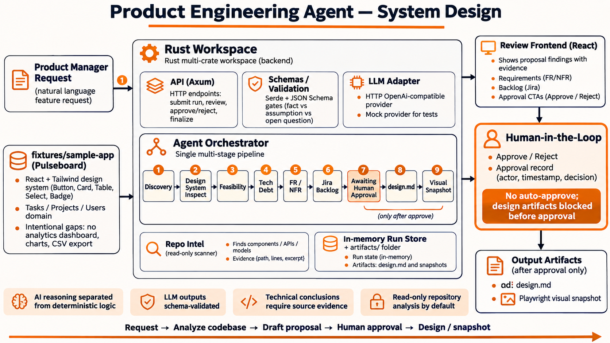

# Product Engineering Agent

**Evidence-based engineering proposals from product requests — before a sprint commitment.**

A Rust-powered agent that inspects a real codebase, drafts feasibility / debt / requirements / Jira-ready backlog with source evidence, then stops for **human approval** before emitting design artifacts.



---

## Why it exists

Product Managers often ask for features without full visibility into architecture, reusable UI, APIs, or hidden debt. Engineering still owns the judgment call — but discovery can be accelerated.

This project demonstrates an AI assistant that:

- **understands before recommending**
- **validates before concluding**
- **asks approval before acting**

> AI should accelerate engineering discovery, not replace engineering judgment.

---

## What you get

| Capability | How it shows up |
|---|---|
| Repository intelligence | Read-only scan of `fixtures/sample-app` with path + excerpt evidence |
| Design-system awareness | Detects reusable UI primitives (Button, Card, Table, Select, Badge) |
| Feasibility & debt | Structured report with fact / assumption / open question labels |
| Requirements engineering | FR/NFR with acceptance criteria |
| Jira-ready backlog | Epics, stories, tasks traced to requirement IDs |
| Human-in-the-loop | Hard gate: no `design.md` / snapshot until approve |
| Review UX | React console for proposals, evidence, and decisions |
| Testability | Mock LLM provider + `cargo test --workspace` + Playwright snapshot |

Demo scenario: *analytics dashboard with filters, charts, and CSV export* against a sample productivity app that intentionally **does not** have those features yet.

---

## Architecture at a glance

Single orchestrator, multi-stage pipeline (not an unbounded agent swarm):

```text
PM request → discovery → design system → feasibility → debt
          → FR/NFR → backlog → HITL approve/reject
          → design.md → visual snapshot
```

| Layer | Implementation |
|---|---|
| API | Rust · Axum · Tokio |
| Agent / HITL | `crates/agent` state machine |
| Repo intel | `crates/repo_intel` (read-only) |
| Schemas | `crates/schemas` + JSON Schema contracts |
| LLM | HTTP OpenAI-compatible + mock (`crates/llm`) |
| Persistence (MVP) | In-memory runs + `artifacts/{run_id}/` files ([ADR-008](docs/adr/ADR-008-in-memory-run-store.md)) |
| Review UI | React · TypeScript · Tailwind |
| Fixture under analysis | `fixtures/sample-app` (Pulseboard) |

Full diagram: [`docs/architecture/system-design.png`](docs/architecture/system-design.png)  
Decisions: [`docs/adr/`](docs/adr/) · Product scope: [`docs/pdr/`](docs/pdr/)

---

## Quick start

**Prerequisites:** Rust stable (on Windows without MSVC: `windows-gnu` + MinGW on `PATH`), Node.js 20+.

```bash
# API (default repo target: fixtures/sample-app)
cargo run -p api
# → http://127.0.0.1:8080

# Review UI
cd frontend && npm install && npm run dev
```

Submit a product request → review evidenced findings → **Approve** or **Reject** → only after approve, generate `design.md` under `artifacts/{run_id}/`.

```bash
# Fixture app (the codebase being analyzed)
cd fixtures/sample-app && npm install && npm run dev

# Tests
cargo test --workspace
cd frontend && npm run test:e2e
```

---

## Documentation map

| Doc | What it is |
|---|---|
| [Challenge specification](docs/requirements/challenge-specification.md) | Original technical brief & DoD |
| [Design options](docs/design/) | Visual directions for prototypes (Pulseboard vs Deal Feed) |
| [ADRs](docs/adr/) | Architecture decisions (topology, evidence, HITL, LLM boundary…) |
| [PDRs](docs/pdr/) | Product decisions |
| [Specs / contracts](docs/specs/) | Proposal, evidence, approval, backlog schemas |
| [DoD evidence](docs/plans/dod-evidence.md) | Checklist mapped to code/tests |
| [AI usage log](docs/process/AI_USAGE.md) | Selection-process disclosure of AI assistance |
| [AGENTS.md](AGENTS.md) | AI-ready operating map for contributors/agents |
| [Solutions](docs/solutions/) | Durable engineering learnings |

Built with a **Compound Engineering** workflow: every material decision records decider, rationale, and files touched.

---

## Status

**MVP complete** (phases 0–8) for a selection-process / portfolio demonstration — not a production multi-tenant SaaS.

Stack choices and tradeoffs are intentional and documented; start at the [challenge specification](docs/requirements/challenge-specification.md) if you want the original requirement text.
