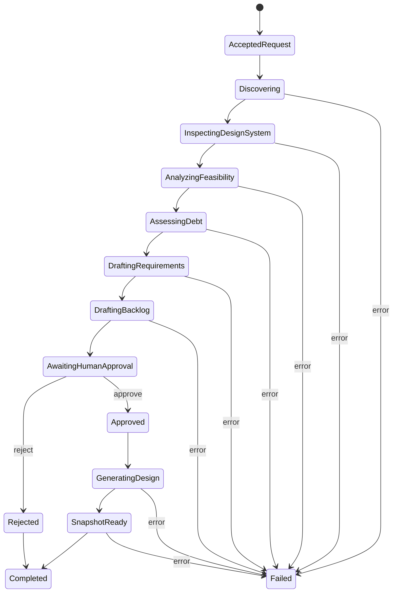

# HITL state machine

## Invariants

1. `approve` / `reject` only from `AwaitingHumanApproval`.
2. `design.md` and snapshots only after `Approved`.
3. ApprovalRecord required on approve/reject transitions.
4. No implicit transition to `Approved`.
